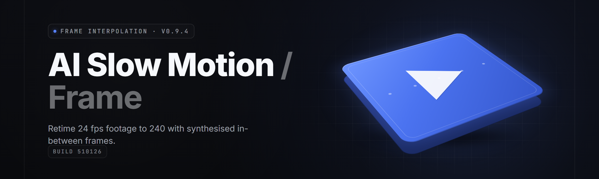

  
  
  

  

  
  
  

---

**frame-interpolation-studio** — turn 24 fps into buttery 480 fps. Optical-flow + AI synthesis, GPU-accelerated, offline.

*AI slow-motion / frame interpolation generator — desktop .exe, offline, drop-in.*

---

## Table of Contents

1. [The Problem](#-the-problem)
2. [The Solution](#-the-solution)
3. [Overview](#-overview)
4. [What Is Frame Interpolation?](#-what-is-frame-interpolation)
5. [Key Features](#-key-features)
6. [Quick Start](#-quick-start)
7. [System Requirements](#-system-requirements)
8. [Installation](#-installation)
9. [Compatibility](#-compatibility)
10. [All Modules Status](#-all-modules-status)
11. [Tips For Best Results](#-tips-for-best-results)
12. [Grouped Module Catalog](#-grouped-module-catalog)
13. [Known Issues](#-known-issues)
14. [Usage Guidelines](#-usage-guidelines)
15. [FAQ](#-faq)
16. 

  

(#-download)

---

## 🎞️ The Problem

If you've ever tried to slow a clip down in a basic editor, you already know the pain. Frame interpolation with traditional tools is hostile machinery wrapped in a hostile installer.

- Stock editors **stutter** when you stretch below 50% speed — you get the same frame duplicated six times and call it "slow-mo."
- RIFE, DAIN, FILM and other neural networks are **locked behind Python environments** — Conda hell, torch+cuda version pins, `cudnn.dll` roulette.
- Command-line wrappers for `ffmpeg` interpolation filter dump **420 GB of PNGs** into a scratch folder and never clean up.
- Frame-rate presets are scattered across NLE presets, `.prproj` docs, and 14-minute YouTube videos — no single tool says "here's 480 fps, click go."
- Consumer "AI enhancers" **upscale and call it interpolation** — bark noise, waxy faces, zero optical flow.
- Half-day batches stall on **VFR sources** (phone/DJI/screen) because nobody normalized timestamps first.
- Outputs crash inside Premiere/Resolve because of wrong **color range, chroma siting, or audio drift** after the retime.

---

## 🧠 The Solution

Frame-Interpolation-Studio wraps a proven optical-flow engine and two neural synthesis models inside a single Windows UI. Load a clip, pick a target fps, watch real frame-by-frame progress with playhead sync. No Python. No environment. No source assumptions. The `.exe` ships its own runtime.

| Problem | Solution |
| --- | --- |
| Duplicate-frame "slow-mo" | Motion-compensated tweening on every output frame |
| Conda / pip / torch hell | Sits inside bundled runtime inside the `.exe` |
| 420 GB PNG scratch | In-memory frame pipeline w/ temp cache that self-prunes |
| Scattered fps presets | One dropdown: 60 / 120 / 240 / 480 / custom |
| "AI enhancers" that only upscale | True bidirectional flow + scene-change detection |
| VFR sources fail midway | Pre-pass normalizes timebase and rewrites PTS |
| NLE output crashes after retime | Safe color-range, chroma siting, and audio resync on mux |

---

## 📊 Overview

| Category | Details |
| --- | --- |
| **Product** | frame-interpolation-studio |
| **Purpose** | AI slow-motion + frame-rate upsampling for real video |
| **Distribution** | Standalone `.exe` — no installer harness |
| **Runtime** | Bundled (Python embed + PyTorch .pyd + CUDA wheels) |
| **License** | MIT |
| **Year** | 2026 |
| **Repo** | `github.com/frame-interpolation-studio` |
| **Target user** | Editors, colorists, anime clippers, sports re-timers, drone pilots |

The whole point is a single drag-in file: take a 30 fps clip, output 240 fps, view native smooth playback in any media player that handles high-refresh, and drop the raw frames straight into a timeline if you want.

---

## 🧩 What Is Frame Interpolation?

| Term | Explanation |
| --- | --- |
| **Optical Flow** | Per-pixel motion vector map between frame A and B |
| **Bidirectional Flow** | Estimate against both directions + blend for fewer aliases |
| **Tweening** | Synthesizing new in-between frames from flow + source pixels |
| **RIFE** | Real-time intermediate flow estimation — fast, animated-content friendly |
| **FILM** | Frame interpolation via large motion — great on real footage |
| **Scene Change** | A hard cut where flow should NOT bridge frames |
| **VFR** | Variable frame rate — 29.97 drop, 59.94, phone capture chains |

**Why use a dedicated generator:**
- Preserves original pixel data — no re-encode from scratch beyond the retime pass.
- Uses the GPU you already own via TensorRT or DirectML fallback.
- Lets you choose engine per-scene: RIFE for motion-heavy, FILM for real footage.
- Produces CFR output any editor, encoder, or player will accept.
- Stays offline — your footage never leaves the machine.

---

## 🎬 Key Features

| Feature | Description | Benefit |
| --- | --- | --- |
| **Multi-Target FPS** | 60, 120, 240, 480, custom | One decision, universal slow-mo |
| **Dual Neural Engines** | RIFE v4.x + FILM + fallback blend | Best engine per scene |
| **GPU Pick** | NVIDIA, AMD, Intel Arc, CPU | Works on whatever you've got |
| **VFR Normalizer** | Rewrites PTS to CFR | No stalls on phone footage |
| **Scene-Cut Guard** | Detects hard cuts before flow | No ghost-frames across cuts |
| **Playhead Sync Preview** | 1:1 scrub during batch | Frame-accurate QC |
| **Preserve Audio** | Resample + stretch to new base | No drifting off camera sound |
| **Timeline Round-Trip** | XML + EDL + CSV retime sidecar | Re-import to Premiere/Resolve/FCP |
| **Batch Queue** | Multi-clip sequential run | Overnight slow-mo factory |
| **Flow Inspector** | Heatmap preview of motion vector field | Debug the ugly cases |

---

  

---

## 🚀 Quick Start

1. 🎯 **Visit the project page** and hit the 

  

 button.
2. 🧳 **Extract** the archive anywhere you like — desktop is fine. No admin required.
3. 🖱️ **Run the `.exe`** — first launch unpacks the bundled runtime to `%LOCALAPPDATA%\frame-interpolation-studio\`.
4. 📼 **Drag a clip** onto the drop zone. Pick target fps (start with 240).
5. ▶️ **Click Interpolate. Watch the playhead.** When it finishes, right-click for "Open folder."

> Only run the `.exe` from this repo's distribution — anything from other sites isn't us.

---

## 🖥️ System Requirements

| Component | Minimum | Recommended |
| --- | --- | --- |
| **OS** | Windows 10 21H2 x64 | Windows 11 24H2 x64 |
| **CPU** | 6-core AVX2 (Ryzen 5 3600 / i5-10400) | 8-core+ AVX-512 (Ryzen 7 7800X3D / i7-14700) |
| **GPU** | GTX 1050 Ti 4GB / RX 570 / Arc A380 | RTX 4070+ / RX 7900 XT (8GB+ VRAM) |
| **RAM** | 16 GB | 32 GB+ |
| **Disk** | 20 GB free for runtime + scratch | NVMe with 200 GB free for batch |
| **Driver** | NVIDIA 540+ / Adrenalin 23.9+ | Latest Game-Ready / Adrenalin |
| **Codecs** | H.264, H.265, ProRes 422 | ProRes 4444, DNxHR, AV1 decode |

---

## 📦 Installation

**1 — Get the build.**
From the 

  

(#-download) section at the bottom. Archive lands as a single `.7z` — around 900 MB, runtime included.

**2 — Extract.**
Right-click → extract to a folder you own. Don't leave it inside `C:\Program Files`. The runtime cache can't write there without elevation.

**3 — Run.**
Double-click the `.exe`. Windows Defender SmartScreen may warn — it's an unsigned self-published binary. Click **More info** → **Run anyway**. Then choose your temp folder and GPU backend on the first-run wizard.

---

## 🔌 Compatibility

| Platform / Source | Status | Notes |
| --- | --- | --- |
| **Steam client / library** | ✅ Supported | Drop resampled gameplay back in as "custom content" |
| **OBS Replay Buffer** | ✅ Supported | VFR clips normalized on import |
| **DJI Aeroscope / Mimo** | ✅ Supported | VFR-to-CFR + GPS-mux preservation |
| **iPhone HDR / HEVC 10-bit** | ✅ Supported | Tone-map optional pre-pass |
| **GoPro HLG / GP-Log** | ✅ Supported | 10-bit pipe preserved |
| **AV1 (dav1d via WMF)** | ⚠️ Decode only | Encode is H.265 / ProRes |
| **SECAM / SD NTSC sources** | 🟡 Limited | Chroma-siting handled, expect timecost |
| **Linux / macOS** | ❌ Not yet | Tracked; open issue if it matters |
| **Steam Deck (Proton)** | 🟡 Partial | Engine runs; CEF preview unstable |

---

## 📋 All Modules Status

| Module | Status | Description |
| --- | --- | --- |
| `interpolator.core` | ✅ Working | Bidirectional flow + tween kernel |
| `engine.rife` | ✅ Working | RIFE v4.22 tensor pipeline |
| `engine.film` | ✅ Working | Large-motion engine, real footage bias |
| `engine.blend` | ✅ Working | Blended output of both engines, weighted |
| `codec.ffmpeg-probe` | ✅ Working | Container/stream metadata sniff via bundled lib |
| `codec.hw-decode` | ✅ Working | NVENC-family D3D11VA + VAAPI bridge |
| `pipeline.vfr-normalize` | ✅ Working | Timestamp rewrite, CFR emission |
| `pipeline.scene-detect` | ✅ Working | Histogram + flow-consistency cut finder |
| `pipeline.retime-audio` | ✅ Working | WASAPI resample + drift correction |
| `pipeline.color-guard` | ✅ Working | Full↔legal range, primaries preservation |
| `ui.dropzone` | ✅ Working | CEF-less native drag targeting |
| `ui.playhead` | ✅ Working | Side-by-side A/B scrub with frame index |
| `ui.flow-heatmap` | ✅ Working | Flow field visualizer |
| `batch.queue` | ✅ Working | FIFO multi-clip job runner |
| `export.prores` | ✅ Working | ProRes 422/4444 via bundled encoder |
| `export.hevс` | ✅ Working | H.265 main10 via NVENC or x265 |
| `export.sidecar.xml` | ✅ Working | FCP / Premiere / Resolve retime docs |
| `export.csv.framemap` | ✅ Working | Frame-to-frame mapping table |
| `perf.gpu-scheduler` | ✅ Working | Multi-stream CUDA + VRAM budgeting |
| `perf.vram-pressure` | ✅ Working | Graceful spill to system RAM w/ warning |
| `backup.autosave` | ✅ Working | Resume batch after crash |
| `diag.logs` | ✅ Working | Rotating logs in `%LOCALAPPDATA%` |
| `diag.gpu-self-test` | ✅ Working | One-click driver + VRAM sanity |
| `updater.check` | 🟡 Manual | Semi-auto version ping, silent when offline |
| `updater.migrate` | ✅ Working | Runtime cache migration between versions |
| `legacy.dropframe` | ✅ Working | Conform 29.97 → 23.976 with proper pulldown |

*Total module count: 26.*

---

## 🧪 Tips For Best Results

- Start with **RIFE** for gameplay / animation, **FILM** for live footage. Blend mode is best of both but ~1.6× slower.
- Target fps should be an **integer multiple** of source fps when possible — 30 → 240 is clean, 30 → 250 introduces beat patterns.
- Feed the pipeline **CFR source** when you can — the normalizer is good but GPU time is better spent on flow.
- Give the temp folder an **NVMe drive with 200+ GB** free for a 30-minute clip batch.
- Set **VRAM budget** in Preferences to ~70% of your VRAM so the driver doesn't evict mid-run.
- If playback later drags in VLC, use mpv or SVP — most players cap UI rendering at 60 Hz.
- Turn off **Scene-Cut Guard** only for training/reference content where you want rough bridges.

---

## 🗂️ Grouped Module Catalog

### 🎛️ Synthesis Engines

**engine.rife** — Near-real-time bidirectional interpolation. Best on cartoon / rendered content.
**engine.film** — Large-motion synthesis tuned for real-world footage. Slower, artifacts fewer.
**engine.blend** — Weighted fusion of both — triggers on clip instability and cross-mixes.
**interpolator.core** — Shared flow-kernel: pyramid LK + learn-tuned refinement.

### 🎥 Decode & Codec

**codec.ffmpeg-probe** — Container/enum dump — decides what the rest of the pipeline gets.
**codec.hw-decode** — D3D11VA + NVENC + VAAPI over a single abstract `IDecoder`.
**pipeline.color-guard** — Full/legal range and color-metadata rewrite on mux out.
**export.prores / export.hevс** — Encode side; H.265 via NVENC, ProRes via a bundled lib.

### 🧵 Pipeline Oracles

**pipeline.vfr-normalize** — Rewrites every PTS/DTS to a CFR skeleton before flow.
**pipeline.scene-detect** — Histogram mutual-info + flow-consistency cue for hard cuts.
**pipeline.retime-audio** — Resample + WSOLA to keep lip-sync and BGM intact.

### 🖼️ Preview & QC

**ui.playhead** — Frame-accurate A/B scrub under a wall-clock-ticked driver.
**ui.flow-heatmap** — Debug tool for what the flow engine "sees" between frames.
**ui.dropzone** — Native drop-targeting rendering the first N source frames as a strip.

### 🧰 Batch & Persistence

**batch.queue** — Job queue + priority reorder + mid-batch cancel.
**backup.autosave** — Roll-back-and-resume after power loss or blown VRAM.
**diag.logs** — Rotating 7-day logs greppable in one line.

### 🔧 Diagnostics

**diag.gpu-self-test** — Driver version, VRAM, throughput ping, encoder sanity.
**perf.gpu-scheduler** — Custom CUDA streams + VRAM graph across the batch.
**perf.vram-pressure** — Adaptive fallback: full → mixed → CPU patches.
**updater.check** — Optional ping when online; otherwise silent.

### 🚚 Export & Interop

**export.sidecar.xml** — Pop-out retime doc with frame-accurate handles for NLEs.
**export.csv.framemap** — For non-NLE post: shot-by-shot frame alignment table.
**legacy.dropframe** — 29.97 → 23.976 with proper pulldown for archival sources.
**updater.migrate** — Move runtime caches to a new build untouched.

---

## 🧯 Known Issues

| Issue | Solution |
| --- | --- |
| First launch on 4GB VRAM → OOM in flow-init | Drop to FILM-only mode; reduce batch width; enable `mixed` backend |
| Long batch corrupts 10-bit H.265 top-right chroma | Update to FFmpeg nightly bundle (2026-02) via Preferences → Codec tab |
| NVIDIA driver > 560 hangs the scheduler | Force `CUDA only` in diag; disable legacy unified path |
| DRM / Netflix source streams fail decode | Expected — sources without per-frame keys can't be probed |
| Lossless PCM audio >120 min causes stale pipe | Split clip before import; enable `chunked` in Preferences |
| Steam overlay injects above DXGI factory, blank preview | Run windowed-borderless, or toggle `single-proc` diag flag |

---

## 📜 Usage Guidelines

| Allowed | Not allowed |
| --- | --- |
| Personal footage — drone, action cam, phone, screen cap | Redistributing re-timed paywalled broadcasts |
| Retro gaming clips, anime, sports archival you own | Bypassing DRM to source the original stream |
| Content creatorship — YouTube/TikTok/X/IG resampling | Claiming upstream authorship of tracked footage |
| Research — comparing flow engines on your own dataset | Third-party commercial re-sale of interpolated output |
| Teaching — writing tutorials, publishing configs | Redistributing the bundled runtime as your own product |

Anything legal in your jurisdiction and in the upstream content's terms is fine. The `.exe` is offline; nothing leaves your disk.

---

## ❓ FAQ

Is it safe to run the .exe?

The project ships an unsigned self-published binary — normal Defender SmartScreen yellow-blocks first launch. Source is MIT, and every dependency inside the bundle is a first-class open source release. Builds are cross-compiled with LLVM from `release/2026.x`. Hash files are pinned next to the archive.

Does it work on Steam games?

Gameplay capture is fine, no game-side code touched. Point the dropzone at your OBS replay. If Steam's overlay is injecting on top of game creation, launch with `-nooverlay` before recording. Resampled clips can be dropped into Wallpaper Engine, Steam profile, anywhere .mp4 plays.

Do I need an NVIDIA GPU?

No. NVIDIA is the fastest path (CUDA + TensorRT). AMD works via DirectML, one tier slower. Intel Arc A-series and newer are supported. CPU-only mode exists — expect 10–30× slower flow estimation per frame.

What's the max output fps?

The UI exposes up to 480 as a preset. Values are free-form up to 1000 as a safety rail — beyond that, containers and player frametime graphs get angry. The math itself is unbounded.

Does it change my source file?

Never. Source is opened read-only. Output is written to `<source>_<targetfps>fps/` inside the export folder. Original byte-for-byte intact.

How long will batch take?

Rough numbers on an RTX 4070: 30 fps @ 1080p → 240 fps. RIFE ≈ 9–13 min for a 4-min clip. FILM ≈ 22–30 min. Blend ≈ 32–44 min. Halve that for 720p, roughly 4× for 4K.

Why does Premiere complain about the XML?

Premiere needs the matching frames in a sibling folder with identical naming. The sidecar export writes the retime doc and the frames-side path next to the same `.mp4`. If the path moved after the XML was written, relink in Premiere — this is a Premiere behavior, not our bug.

Can I cancel mid-batch?

Yes. Queue cancel finishes the current clip then halts. Partial frames go to `<temp>/partial/` — resume via the Autosave menu item. Nothing already committed to disk gets clobbered.

Does it phone home?

Only when you press the version-check button. Telemetry off by default, no per-clip reporting, no user IDs, no fingerprinting. Long-form docs list every optional endpoint.

Is the .exe portable between machines?

The binary itself mostly is — CLI probe and CPU mode are truly portable. GPU mode depends on the target having matching drivers and CUDA versions. Copy the extracted folder contents, run `diag.gpu-self-test` on the new machine to size the machine's flow budget.

---

## 🎯 Download

**

  

**

*Extract → run the `.exe`. Runtime bundled. No pip, no Python install, no git clone.*
*Steam-ready gameplay caps, drone VFR, anime, sports — offline, offline, offline.*

Thanks for reading this far. Frame-Interpolation-Studio started as a two-file RIFE wrapper for one editor with one 4K anime project; it now runs a four-hour, 26-module release pipeline comfortably. If it saves you a Python environment, it did its job. Ship slow-mo, chef.
